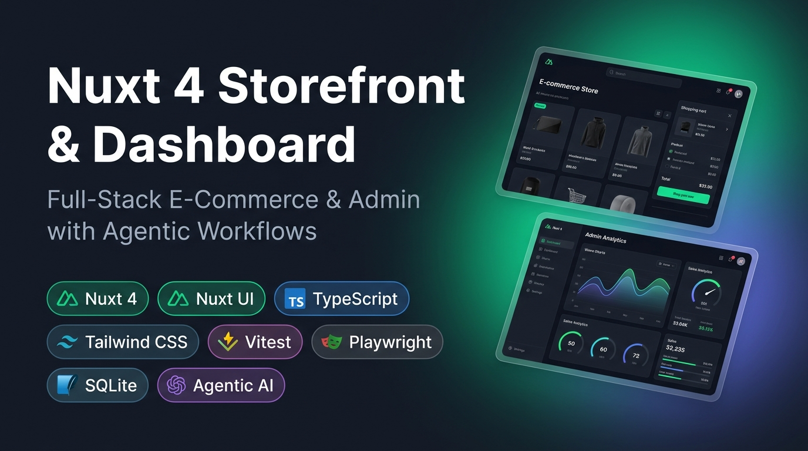

# Nuxt 4 Web Store Project

<p align="center">
  
</p>

<p align="center">
  <strong>A full-stack e-commerce storefront & back-office admin dashboard built with Nuxt 4, Nuxt UI, and Agentic Workflows.</strong>
</p>

<p align="center">
  
  
  
  
  
  
</p>

---

## 📖 About The Project

This repository serves as the official practice project for the **Agentic Coding Sessions**. It is designed for both seasoned developers and workshop attendees without prior software engineering backgrounds.

The project features a complete e-commerce solution:
- **Public Storefront**: Responsive product catalog, search & category filtering, and a reactive shopping cart slideover.
- **Simulated Checkout**: Customer information and address collection with Valibot schema validation and mock order creation.
- **Back-office Admin Dashboard**: Real-time sales metrics, product inventory management with modal creation and slideover editing, and order review.
- **Robust Testing**: Fast unit testing with Vitest and full browser automation with Playwright.

---

## 🛠️ Technology Stack

| Domain | Technology | Purpose |
| :--- | :--- | :--- |
| **Framework** | **Nuxt 4** | Full-stack Vue 3 framework with SSR and Nitro server engine |
| **UI & Tokens** | **Nuxt UI** & **Tailwind CSS** | Accessible component library with semantic design tokens |
| **Data Validation** | **Valibot** | Schema validation for forms, APIs, and models (`import * as v from 'valibot'`) |
| **Internationalization** | **@nuxtjs/i18n** | Localization catalog in `i18n/locales/en-us.json` |
| **Authorization** | **nuxt-authorization** | Role and ability gate checks for admin areas |
| **SEO Optimization** | **nuxt-seo** | OpenGraph tags, sitemaps, and canonical URLs |
| **Unit Testing** | **@nuxt/test-utils** & **Vitest** | Component and composable unit tests |
| **E2E Testing** | **Playwright** | Browser-level purchase and admin workflows |
| **Database** | **SQLite** | Embedded local persistence |
| **Dates** | **date-fns** & **@internationalized/date** | Formatting and Nuxt UI calendar date models |

---

## 🚀 Getting Started (Windows Guide)

Follow these simple steps in **Windows PowerShell** to get up and running:

### Step 1: Install Node.js
Use **Node.js 24 LTS, version 24.15.0 or later within the 24.x release line**, for the course. The installed stack supports `^22.22.3 || ^24.15.0 || >=26.0.0`; Node 20, Node 25, and earlier Node 22/24 versions are unsupported. Check your version:
```powershell
node -v
```

### Step 2: Enable pnpm via Corepack
This project uses `pnpm` exclusively. Node 24 includes Corepack. If another supported Node release does not provide it, bootstrap the official Corepack tool with `npm install --global corepack` first; this does not add a project dependency. Then enable pnpm:
```powershell
corepack enable
corepack prepare pnpm@latest --activate
pnpm -v
```

### Step 3: Clone or Fork Your Repository
Fork this repository to your GitHub account with **Copy the main branch only** unchecked so your fork includes `development`. Clone that branch:
```powershell
git clone --branch development git@github.com:<your-username>/nuxt-web-store-project.git
cd nuxt-web-store-project
git branch --show-current
```

### Step 4: Install Dependencies
Run the installation command:
```powershell
pnpm install
```

### Step 5: Install Project Agent Skills
Install the curated agent skills into `.agents/skills/`:
```powershell
npx skills experimental_install
```

### Step 6: Start the Development Server
```powershell
pnpm dev
```
Open **[http://localhost:3000](http://localhost:3000)** in your browser!

---

## 🧪 Running Automated Tests

### Unit Tests (Vitest)
Fast, in-memory tests for business logic and composables:
```powershell
pnpm test
```
To run tests continuously in watch mode:
```powershell
pnpm test:watch
```

### End-to-End Tests (Playwright)
Run headless browser tests for storefront and admin flows:
```powershell
pnpm test:e2e
```

---

## 📋 GitHub Project & Course Kanban Workflow

The public [Nuxt Web Store Project master board](https://github.com/users/HELWATANY/projects/6) contains **24 Draft Issues** under `HELWATANY`, created from GitHub's built-in Kanban template. The local course catalog remains the content source and records every draft ID and verified card link.

Verified on 2026-11-15: all 24 live draft titles/bodies, Phase values, and three Ready / 21 Backlog assignments match the catalog, with no archived extras. Repeat reconciliation made zero card writes. The board and all 24 card links opened in a signed-out browser. The default Status board and all five visible columns were also verified. Disabling auto-add workflows and copy-dialog inspection remain pending in [issue #2](https://github.com/HELWATANY/nuxt-web-store-project/issues/2); an actual attendee-copy test has not been performed.

### Kanban Board Layout & Columns:
- **`Backlog`**: Holds upcoming tasks for Phases 1 through 5.
- **`Ready (Todo)`**: Active sprint tasks ready for agent assignment (Phase 0).
- **`In Progress`**: Tasks actively being implemented by agents/attendees.
- **`In Review`**: Automated test verification and PR review.
- **`Done`**: Feature verified and merged into `development`.

### Copy the Course Board and Create Your Repository Issues

1. Select **Make a copy** on the master board, explicitly check **Draft issues**, choose your own account as Owner, and name the copy before confirming. Do not rely on the checkbox's default state.
2. Keep every card on the instructor's master board as a draft. Existing repository issues and PRs are not duplicated when copying a project.
3. Enable **Issues** in your own repository settings if necessary. On your copied board, open a draft, select **Convert to issue**, and choose your attendee repository, such as `<your-username>/nuxt-web-store-project`.
4. Use the resulting repository issue numbers for branches, commits, and PRs. A curriculum task ID such as `4.6` is not a GitHub issue number. Branch from `development` and target PRs back to `development` following `AGENTS.md`.

See [GitHub's documented copying workflow](https://docs.github.com/en/issues/planning-and-tracking-with-projects/creating-projects/copying-an-existing-project). Copying can preserve selected drafts and their field values; inspecting the copy dialog alone does not verify a completed attendee copy.

### Instructor Provisioning

Prepare and validate the catalog first. Create the built-in Kanban project in the browser, record its node ID/number/URL in the catalog immediately, then configure fields and publish the catalog bodies through GraphQL. Configure and save the default Status board in the browser; re-query existing task IDs before retries, repair incomplete assignments, and stop on duplicate or unexpected items. Keep the master at 24 drafts: three Phase 0 cards in `Ready (Todo)` and 21 cards in `Backlog`.

Preserve inaccessible checkpoint identities as historical evidence. Recheck all owner projects, including closed projects, before creating a replacement; stop on multiple candidates, a closed match, or identity conflicts. Check all items, including archived items, before each add/retry and stop on archived or unrelated content. Reconcile incorrect as well as missing Phase/Status values. Record item/draft IDs immediately and add links only after verification. Show all five board columns, including empty ones, and disable auto-add and auto-archive workflows. Verify public access and inspect/cancel the copy dialog separately from an actual attendee-copy test.

The legacy `scripts/setup-github-project.mjs` is **not a complete provisioner for this specification**. It contains an older hardcoded catalog and does not configure the required template, visibility, fields, saved view, or retry recovery. Updating the helper is outside this change.

In the full local course workspace, see [`../documents/github-project-issues-catalog.md`](../documents/github-project-issues-catalog.md) for all 24 bodies, the provisioning checkpoint, and verification steps. That sibling documentation directory is outside this Git repository. Repository README/agent-rule edits still require an issue-linked branch and must preserve local work.

### Course Access and Order History

The course uses installed Nitro/h3 sealed-cookie sessions and `nuxt-authorization`, with no new authentication dependency. Guest receipts belong to the original browser session; order IDs alone grant no access. The demo administrator is opt-in for development/tests and disabled in production. A production administrator login requires a separate authentication implementation.

The server owns order IDs, ownership, timestamps, status, prices, and totals. Product/API/cart/order amounts use integer USD cents; forms and displays convert to/from dollars at the UI boundary. Order-line snapshots preserve the original purchase details after product edits/deletion. Payment is explicitly simulated and collects no real card credentials. These contracts are specified in the catalog's Tasks 1.1–1.4, 3.1–3.3, and 4.1–4.7; application implementation remains course work.

---

## 🗂️ Project Directory Layout

Following Nuxt 4 conventions:
```
nuxt-web-store-project/
├── app/                        # All Vue frontend code (Nuxt 4 default srcDir)
│   ├── app.vue                 # Root application wrapper (wrapped in UApp)
│   ├── assets/css/main.css     # Tailwind styling
│   ├── layouts/
│   │   ├── default.vue         # Public Storefront layout
│   │   └── admin.vue           # Back-office Admin layout
│   ├── pages/
│   │   ├── index.vue           # Product catalog storefront
│   │   └── admin/index.vue     # Admin overview & metrics
│   └── composables/            # Auto-imported composables (e.g. useCart)
├── i18n/
│   └── locales/en-us.json      # Central translation catalog
├── server/
│   └── api/
│       └── health.get.ts       # Nitro server REST API routes
├── public/
│   └── social-preview.png      # Social preview banner asset
├── tests/
│   ├── unit/                   # Vitest unit test suite
│   └── e2e/                    # Playwright browser test suite
├── nuxt.config.ts              # Nuxt configuration & module options
├── vitest.config.ts            # Vitest test runner configuration
├── playwright.config.ts        # Playwright E2E configuration
├── AGENTS.md                   # Repository governance & agent rules
└── README.md                   # Project documentation
```

---

## 📚 Curriculum & Phase Plan

For the full course plan, step-by-step agent prompt cards, and learning guides for HTML, CSS, JavaScript, Vue, and Nuxt, open:
- **`../documents/session-phase-plan.html`** in your browser.
